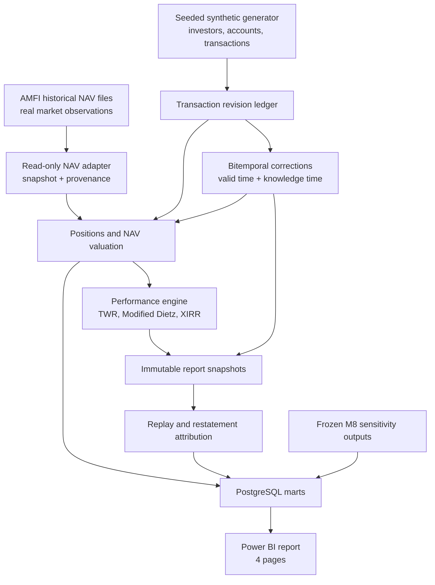

# Portfolio Accounting & Performance Engine

**A reproducible portfolio subledger and performance-reporting prototype built with Python, PostgreSQL and Power BI.**

> **Educational prototype.** Investor accounts and transactions are synthetic; market-price inputs are real AMFI mutual-fund NAV observations. This project is not investment advice, a production portfolio-management system, or a claim of SEBI/GIPS/regulatory compliance.

## Why this project exists

A portfolio report is not just a number calculated from today's database rows. A performance or operations analyst may need to explain what a portfolio was worth at a past date, what information the system had when a report was issued, and why that report changed after a backdated transaction correction.

A simple overwrite-in-place design can retain the corrected current position while losing the earlier transaction state needed to reconstruct what was originally reported. That creates a practical auditability and reporting problem: **can the system reproduce the original report, show the corrected report, and trace the difference to the transaction revision that caused it?**

This project explores that problem through a simulated wealth-management operation. It combines real AMFI NAV observations with deterministic synthetic investors, accounts and transactions, then builds an auditable portfolio subledger that supports historical positions, valuation, performance measurement, corrections, report replay and restatement attribution.

The product is the portfolio accounting and reporting workflow. **Bitemporal modelling is the mechanism** used to preserve both:

- **Valid time:** when a transaction is economically effective.
- **Knowledge time:** when the system accepted that version of the transaction.

For example, a January purchase corrected in February must change the February-known view of January, but it must not rewrite what a report generated in January originally knew.

## What it does

- Imports canonical historical AMFI NAV observations with source-file provenance and snapshot identity.
- Generates deterministic synthetic investors, accounts, transactions, SIPs, switches and correction intents.
- Maintains an immutable transaction-revision source with rebuildable temporal and current-state projections.
- Reconstructs account cash and mutual-fund positions for a selected effective date and knowledge timestamp.
- Values Growth-plan mutual-fund holdings using NAV observations, with explicit stale/missing-NAV handling.
- Calculates time-weighted return (TWR), Modified Dietz and money-weighted XIRR using documented conventions and decimal arithmetic.
- Stores report snapshots, replays historical reports, generates restatements and attributes changes to transaction revisions.
- Compares the bitemporal approach with an overwrite-in-place baseline.
- Runs a pre-registered sensitivity study on real NAV paths to quantify how controlled transaction-date/amount errors move reported returns.
- Exposes portfolio, account, audit and sensitivity views through a four-page Power BI report and an ad-hoc SQL pack.

## Project at a glance

| Item | Evidence / scope |
|---|---|
| Canonical market data | **1,811,703** AMFI NAV observations across **85** approved source-file ranges; 779 schemes; 2 April 2006–6 November 2026 |
| Additional test data | 6 synthetic NAV fixtures isolated in a separate `test_fixture_nav_seeds` snapshot; not included in the canonical AMFI count |
| Synthetic portfolio dataset | Baseline generator run: 12 accounts, 2,287 transactions and 148 correction intents; seed `20261109` |
| Demonstration correction workflow | Deterministic walkthrough with an applied correction, a rejected correction, an original report, exact replay and a restated report |
| Sensitivity evidence | 11,436 detail observations; E9 has 1,040 eligible windows, 654 solved and 386 excluded for no-root/solver-domain reasons |
| Dashboard | Four Power BI pages; Page 4 uses the accepted drawdown-quintile bar-chart presentation for E9 |
| SQL | 10 ad-hoc business-question queries, plus versioned migrations and analytical marts |

Counts above describe the documented baseline and project artifacts; they are not claims about real investors, clients, AUM, transaction prevalence or market-wide error rates. See [`RESULTS.md`](RESULTS.md), [`docs/DATA_CARD.md`](docs/DATA_CARD.md) and [`docs/V1_0_0_RC_FINAL_REPORT.md`](docs/V1_0_0_RC_FINAL_REPORT.md) for provenance and verification qualifications.

## How the system works



### Core design choices

1. **Real prices, synthetic accounts.** AMFI NAV observations provide market inputs; all investors, accounts, transactions and correction behaviour are generated and labelled synthetic.
2. **Immutable revision facts.** Accepted transaction revisions are append-only. Temporal intervals and current-version state live in rebuildable projections.
3. **Two time axes.** Effective business date and recorded/knowledge time are kept separate so a later correction cannot alter an earlier knowledge-time query.
4. **Decimal financial arithmetic.** Python `Decimal` and PostgreSQL `NUMERIC` are used for money, NAV, units and return inputs; rounding is explicit and documented.
5. **Replay is not retrieval.** The system distinguishes fetching an archived report, recalculating it under its original inputs/versions, and producing a later restatement.
6. **Negative or partial results stay visible.** E9 is partial, E6 latency percentiles are not claimed, and the project does not present a screening or performance result as investment advice.

## Dashboard

The Power BI PBIP report is in [`dashboard/PortfolioReport/Workbook.pbip`](dashboard/PortfolioReport/Workbook.pbip). The four pages are:

1. **Portfolio Overview** — latest eligible portfolio value, holdings and cash; portfolio history; monthly external flows; allocation; report summary.
2. **Account Drilldown** — account/date selection, holdings, NAV, units, cash, valuation history and transaction ledger.
3. **Restatements & Audit** — correction/rejection counts, K1/K2 comparison, report snapshots, replay status and revision history.
4. **Sensitivity** — M8 scenario summaries and the accepted E9 drawdown-quintile bar-chart presentation.

Screenshots: [`docs/screenshots/`](docs/screenshots/). The report uses a local PostgreSQL connection (`127.0.0.1:5434`); data-bearing `.pbix` files are intentionally not committed.

## Results and verification status

| Area | Recorded result | Qualification |
|---|---|---|
| NAV ingestion | 1,811,703 canonical observations; 85 source-file ranges; zero duplicate `(snapshot, scheme, date)` keys | Canonical source count; 6 test fixtures are separately snapshotted |
| Synthetic generator | 12 accounts, 2,287 transactions; dataset hash begins `94839c5c` | Fixed seed/config baseline; all account data is synthetic |
| Performance calculations | 17 hand-computed fixtures; independent XIRR reference agreed within the documented 1 bp tolerance on eligible fixtures | Recorded test evidence; not freshly rerun in the final RC environment |
| Reproducibility | Prior two-run `RESULTS.md` hash begins `ac6257e2` | Historical baseline; a fresh clean double-run was not re-executed during the final RC check |
| Automated tests | Last recorded successful suite: **75 passed** in the prepared Python 3.12/PostgreSQL 16 environment | Not freshly rerun in the final RC verification environment |
| Sensitivity | E8 complete; E9: 654/1,040 solved, 386 excluded; 11,436 detail rows | Frozen configuration; E9 remains partial and exclusions are documented |
| Query performance | E6 deterministic-query behaviour tested | p50/p95 latency benchmarking is **not claimed** |

The frozen M8 configuration SHA-256 is recorded in [`RESULTS.md`](RESULTS.md). E9 reports **annualised XIRR minus period TWR** over the same 12-month SIP window; the difference is between two different return measures, not an error metric.

### Current release status

The repository is published on GitHub `main` as a **release candidate**. The final verification report distinguishes checks verified from database/files, checks supported by prior recorded evidence, and checks not freshly re-executed. In particular, the latest RC verification did **not** freshly rerun the full test suite/Ruff, migration checksum-tamper test, source NAV re-import, or two clean `make reproduce` runs; Power BI Desktop interaction validation and remote GitHub Actions execution also remain unverified in that pass.

Do not describe this as a fully verified production release. See [`docs/V1_0_0_RC_FINAL_REPORT.md`](docs/V1_0_0_RC_FINAL_REPORT.md) for the exact evidence and limitations. No final v1.0.0 tag or GitHub Release is claimed here.

## Run locally (Windows / PowerShell)

### Prerequisites

- Python **3.12.x** (the project currently constrains Python to `>=3.12,<3.13`).
- Docker Desktop with Docker Compose.
- The approved FundLens raw AMFI archive available locally. The data files are not bundled in this repository and must remain local; follow the source terms documented in [`docs/DATA_CARD.md`](docs/DATA_CARD.md).

### 1. Clone and configure

```powershell
git clone https://github.com/Vicky231006/portfolio-accounting-engine.git
cd portfolio-accounting-engine
Copy-Item .env.example .env
```

Edit `.env` and set a non-default local `POSTGRES_PASSWORD`. Keep `.env` untracked. The example file contains placeholders only.

Set the same connection string in the current PowerShell session for the Python commands (Docker Compose reading `.env` does not automatically export it into your host shell):

```powershell
$env:DATABASE_URL = "postgresql://postgres:<your-local-password>@127.0.0.1:5434/bitemporal_ledger"
$env:FUNDLENS_RAW_DIR = "C:\path\to\fundlens"
```

`FUNDLENS_RAW_DIR` points to the FundLens repository root; the reproduction script expects its `data\raw\amfi` subdirectory. FundLens is consumed read-only.

### 2. Start PostgreSQL and install dependencies

```powershell
docker compose up -d postgres
py -3.12 -m venv .venv
.\.venv\Scripts\Activate.ps1
python -m pip install --upgrade pip
python -m pip install -e ".[dev]"
```

### 3. Migrate and validate

```powershell
python scripts/migrations/runner.py
python -m ruff check .
python -m pytest tests -q
```

### 4. Reproduce the documented pipeline

Run against a **dedicated empty project database**. The reproducibility workflow imports NAVs, generates synthetic records, runs the portfolio pipeline and writes `RESULTS.md`.

```powershell
.\make.ps1 reproduce
```

The standard `make reproduce` target is also available on systems with GNU Make. Do not point the project at FundLens's database. The scripts use the `DATABASE_URL` supplied for this project.

## Repository map

```text
├── config/                 # Generator and frozen sensitivity configuration
├── dashboard/              # Power BI PBIP report and semantic model
├── docs/                   # BRD, methodology, data card, decisions, briefings and audits
├── results/                # Frozen sensitivity evidence and coverage report
├── scripts/                # Import, migrations, generation and reproduction CLIs
├── sql/
│   ├── migrations/          # Versioned PostgreSQL migrations
│   ├── marts/               # Dashboard/reporting marts
│   └── adhoc/               # 10 business-question SQL queries
├── src/bitemporal_ledger/   # NAV adapter, generator, ledger, valuation, performance, reporting
├── tests/                   # Unit, property and PostgreSQL integration tests
├── DECISIONS.md             # Architecture and methodology decision log
├── RESULTS.md               # Evidence-backed results and limitations
└── prompt.md                # Original implementation/agent operating prompt
```

## Limitations and boundaries

- **Synthetic accounts and transactions:** no real clients, users, AUM or real-world error prevalence are represented.
- **AMFI NAV scope:** Growth-plan NAV inputs are used for the portfolio model. Historical scheme coverage, category history and survivorship limitations are documented in the data card.
- **No fees, taxes, IDCW cash events, multi-currency, equities, bonds or derivatives** in v1.
- **E9 partial:** 654 of 1,040 eligible windows were solved; 386 were excluded under the documented solver-domain/no-root handling. The sensitivity scenarios are controlled experiments, not observed market error rates.
- **E6 latency:** p50/p95 query latency claims are not made.
- **Power BI:** PBIP definitions and screenshots are committed; full Desktop refresh/interaction validation is not claimed as part of the final RC verification pass.
- **CI:** GitHub Actions workflow is present; remote workflow execution has not been recorded as successful.
- **Not a compliance system:** no SEBI, SEC or GIPS compliance claim; no investment recommendations.

## Project documentation

- [`PRD.md`](PRD.md) — product requirements and milestone gates.
- [`docs/BRD.md`](docs/BRD.md) — business problem and current-process gap.
- [`docs/METHODOLOGY.md`](docs/METHODOLOGY.md) — financial and temporal conventions with worked fixtures.
- [`DECISIONS.md`](DECISIONS.md) — why key architecture and methodology decisions were made.
- [`docs/REQUIREMENTS_TRACEABILITY.md`](docs/REQUIREMENTS_TRACEABILITY.md) — PRD requirements mapped to implementation and evidence.
- [`RESULTS.md`](RESULTS.md) — reproducible result values and qualifications.
- [`docs/V1_0_0_RC_FINAL_REPORT.md`](docs/V1_0_0_RC_FINAL_REPORT.md) — release-candidate evidence and outstanding checks.
- [`DEVELOPMENT_HISTORY.md`](DEVELOPMENT_HISTORY.md) — M0–M10 development narrative and Git-history context.

---

**Built as a learning and portfolio project:** to demonstrate how wealth-management portfolio data can be accounted for, corrected, valued and reported with a reproducible audit trail—not to imitate or claim the internal systems of any financial institution.
